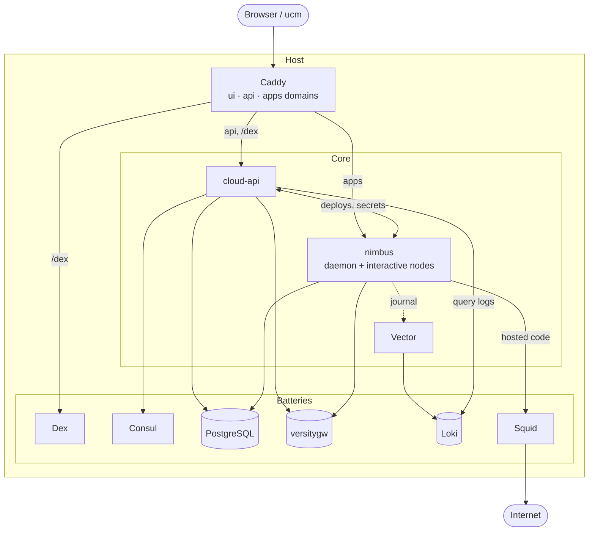

# Unison Cloud in a NixOS module

> [!WARNING]
> This is super experimental. Unison only just open sourced the pieces of Unison Cloud, and I'm running them in ways they were never really meant to run. So:
> - Expect things to break
> - Expect the options to change out from under you
> - Don't put anything you care about on it yet

This flake runs your own little [Unison Cloud](https://www.unison.cloud/) on NixOS. It packages cloud-api, nimbus, and the web UI, patches them so they work without any of Unison's hosted infrastructure including a hacky patched in auth system, and wires everything together under `services.unison-cloud`. You get a cluster you can log in to with `ucm`, deploy services and daemons to, and watch in the web UI.

It comes as two NixOS modules. `nixosModules.core` runs cloud-api, nimbus and Vector, and expects you to bring the rest: PostgreSQL, an S3 store, an OIDC login provider, Consul, Loki and a reverse proxy. `nixosModules.batteries` bundles all of those on the same host and wires them into core. The demo VM imports both.

## Try it out

The quickest way in is the demo VM. It boots the whole stack in QEMU and serves it on `localhost:8080`.

```sh
nix run .#demo
```

> [!NOTE]
> Building all of this from scratch may take a long time, mostly cloud-api's Haskell build and compiling nimbus. The flake already points at a binary cache in its `nixConfig`, so just say yes when Nix asks to trust it. See [Use the binary cache](#use-the-binary-cache) if it doesn't ask.

Once it's up you get:

- UI: http://ui.unison.localhost:8080
- API: http://cloud.unison.localhost:8080
- Deployed services: http://apps.unison.localhost:8080/services/s/demo/<service-name>/
- Login: `demo@unison.localhost` / `demo`

> [!IMPORTANT]
> The demo leans on `*.localhost` names resolving to loopback. Most browsers do this on their own, but `ucm` uses your system's resolver, so you need a system where it works too. On many Linux distros, systemd-resolved or glibc's `nss-myhostname` handle it by default. Check with `getent hosts cloud.unison.localhost`.
>
> If that's not an option, you'll have to mess around with the domain configs. Caddy routes by hostname, so a raw IP on its own won't work. You still need three names, either from `/etc/hosts` entries or something like [nip.io](https://nip.io). And plain `http` is only allowed when every domain ends in `.localhost`, so anything else means turning on TLS too.

The demo user already has a hello-world service deployed at http://apps.unison.localhost:8080/services/s/demo/hello/.

To deploy your own code to it, log `ucm` in to the cluster and then start `ucm` from the demo shell, which points the cloud client at the VM:

```sh
# Logs you into the local cloud for cloud.unison.localhost:8008
# It leaves your main Unison Share alone
$ nix run .#demo-login
$ nix develop .#demo
$ ucm
```

From there anything that you just use the normal Unison Cloud client to interact with your cloud in a bottle.

## Deploy for Real

Even I have barely done this, so YMMV to the extreme. To run everything on one machine, import both modules and set at least the three domains:

```nix
{lib, ...}: {
  imports = [
    inputs.unison-cloud-nix.nixosModules.core
    inputs.unison-cloud-nix.nixosModules.batteries
  ];

  services.unison-cloud = {
    enable = true;
    domains = {
      api = "cloud.example.com";
      apps = "apps.example.com";
      ui = "ui.example.com";
    };
  };

  # Batteries runs Consul, which nixpkgs marks unfree.
  nixpkgs.config.allowUnfreePredicate = pkg: lib.getName pkg == "consul";

  # Caddy is the only thing that should face the network.
  networking.firewall.allowedTCPPorts = [80 443];
}
```

Keep the UI and API domains under the same parent domain. The session cookie only rides along on the UI's requests when they're the same site. Add users to log in with through `services.unison-cloud.batteries.dex.users`, or use the generated admin account. `nix/demo/configuration.nix` is a good full example.

Each battery has its own switch under `services.unison-cloud.batteries`, such as `batteries.caddy.enable = false`, so you can swap any of them for a service you already run.

## Deploy on a shared host

If the host already runs its own Caddy, login provider, PostgreSQL, S3 store, Consul agent and Loki, import only `nixosModules.core` and point it at them. Core runs cloud-api, nimbus and Vector, plus oneshot units for its secrets and its Consul registrations, and nothing else.

This example is for a host whose Caddy wraps each vhost's body in its own `tls` block, with Pocket ID on `127.0.0.1:1411`, the host's PostgreSQL, Garage on a private network, a local Consul agent and Loki on `127.0.0.1:3100`:

```nix
{config, ...}: let
  cloud = config.services.unison-cloud;
in {
  imports = [inputs.unison-cloud-nix.nixosModules.core];

  services.unison-cloud = {
    enable = true;
    domains = {
      api = "cloud.example.com";
      apps = "apps.example.com";
      ui = "ui.example.com";
    };

    auth.oidc = {
      issuer = "https://login.example.com";
      clientId = "unison-cloud";
      # The browser follows the public authorization URL. cloud-api fetches tokens and
      # keys from Pocket ID's own listener, so it doesn't depend on the public name.
      endpoints = {
        authorization = "https://login.example.com/authorize";
        token = "http://127.0.0.1:1411/api/oidc/token";
        jwks = "http://127.0.0.1:1411/.well-known/jwks.json";
      };
      allowedGroups = ["unison-cloud"];
    };

    s3 = {
      # Garage's root_domain is ".s3.garage.example.com", and the host resolves it and
      # every bucket under it.
      host = "s3.garage.example.com";
      port = 3900;
      https = false;
      region = "garage";
      buckets = {
        services = "unison-cloud-example-services";
        userBlobs = "unison-cloud-example-user-blobs";
      };
    };

    database.host = "127.0.0.1";
    logs.lokiUrl = "http://127.0.0.1:3100";

    # Each encrypted under its own name, for example
    # systemd-creds encrypt --name=oidc-client-secret - /etc/credstore.encrypted/unison-cloud-oidc-client-secret
    secrets.credentials = {
      oidc-client-secret = "unison-cloud-oidc-client-secret";
      s3-access-key-id = "unison-cloud-s3-access-key-id";
      s3-secret-access-key = "unison-cloud-s3-secret-access-key";
      cloud-api-db-password = "unison-cloud-cloud-api-db-password";
      nimbus-db-password = "unison-cloud-nimbus-db-password";
      consul-token = "unison-cloud-consul-token";
    };
  };

  services.caddy.virtualHosts = {
    "cloud.example.com".extraConfig = cloud.caddy.siteConfig.api;
    "apps.example.com".extraConfig = cloud.caddy.siteConfig.apps;
    "ui.example.com".extraConfig = cloud.caddy.siteConfig.ui;
  };
}
```

Here's what each piece expects from the host:

- **The reverse proxy.** `caddy.siteConfig` holds a complete site body for each domain, for any Caddy. Any other proxy sends the API domain to `ingress.upstreams.api` and balances the apps domain across `ingress.upstreams.apps`, both on loopback. Keep cloud-api's `/internal/*` routes private, as the Caddy bodies do. Point a monitor at `https://cloud.example.com/.well-known/openid-configuration`. It needs no login, and a 200 means the proxy and cloud-api are up.
- **The login provider.** Give it a confidential client with the redirect URI `https://cloud.example.com/selfhost/oidc/callback`. cloud-api still checks every ID token's `iss` against the public issuer.
- **PostgreSQL.** Create two roles, each with a password and its own database, so neither can read the other's tables. nimbus runs hosted code, so its role must never reach cloud-api's data. Both log in over TCP. The module creates no roles or databases and never edits `pg_hba.conf`; NixOS's default `host all all 127.0.0.1/32 md5` rule lets them log in from loopback. As the PostgreSQL superuser:

  ```sql
  CREATE ROLE unison_cloud LOGIN PASSWORD '...';
  CREATE DATABASE unison_cloud OWNER unison_cloud;
  REVOKE ALL ON DATABASE unison_cloud FROM PUBLIC;
  \c unison_cloud
  CREATE EXTENSION "uuid-ossp";
  CREATE EXTENSION citext;
  CREATE EXTENSION moddatetime;
  CREATE ROLE unison_cloud_nimbus LOGIN PASSWORD '...';
  CREATE DATABASE unison_cloud_nimbus OWNER unison_cloud_nimbus;
  REVOKE ALL ON DATABASE unison_cloud_nimbus FROM PUBLIC;
  ```

- **S3.** Create both buckets and a key that can read and write them. nimbus addresses buckets as `<bucket>.<host>`, so each bucket's name must resolve on the host.
- **Consul and Loki.** See [Use an existing Consul cluster](#use-an-existing-consul-cluster) for the token. Loki needs nothing special: Vector ships nimbus's logs to `logs.lokiUrl` with the labels cloud-api queries.

cloud-api and nimbus listen on every address, and their ports start at 24100. Core opens no firewall ports, so NixOS's default `networking.firewall` keeps them off the LAN. Open them yourself only when nimbus and cloud-api run on separate hosts; see `cloudApi.enable`, `nimbus.cloudApiHost` and `advertiseAddress`.

## Use an existing Consul cluster

Everything the stack keeps in Consul sits under one prefix, `consul.prefix` (`unison-cloud` by default): KV keys under `<prefix>/` and service names starting with `<prefix>-`. So it can share a cluster that runs with `default_policy = "deny"`. The module writes the ACL policy it needs to `config.services.unison-cloud.consul.aclPolicy`. Create the policy and a token from it on the cluster:

```sh
policy=$(nix build --no-link --print-out-paths .#nixosConfigurations.<host>.config.services.unison-cloud.consul.aclPolicy)
consul acl policy create -name unison-cloud -rules @"$policy"
consul acl token create -policy-name unison-cloud -description "Unison Cloud"
```

Then supply the token's secret ID as `consul-token`. cloud-api talks to the host's local agent over plain HTTP at `consul.address`, `http://127.0.0.1:8500` by default:

```nix
services.unison-cloud = {
  # Encrypted with --name=consul-token.
  secrets.credentials.consul-token = "unison-cloud-consul-token";
};
```

`unison-cloud-consul-services` registers the host's nimbus client ports and cloud-api with the local agent, as `<prefix>-nimbus-client` and `<prefix>-cloud-api`, while it runs, and deregisters them when it stops. Each host registers only its own services, so several hosts can share a cluster without coordinating.

## Use the binary cache

Building cloud-api and nimbus from scratch takes a long time, so I push the builds to a Cachix cache, [unison-cloud-in-a-bottle](https://unison-cloud-in-a-bottle.cachix.org). The flake already lists it in `nixConfig`, so when you `nix run` or `nix develop` here Nix asks whether to trust it. Say yes and it pulls the binaries instead of building them.

If you're not a trusted user in your Nix config, Nix ignores the flake's `nixConfig` and builds everything locally. Add the cache to your system instead:

```nix
nix.settings = {
  extra-substituters = ["https://unison-cloud-in-a-bottle.cachix.org"];
  extra-trusted-public-keys = ["unison-cloud-in-a-bottle.cachix.org-1:egpjVQf3JrKM0bo39Gh3JKOMeEbyyk8t0VSH6455r8w="];
};
```

The cache has cloud-api, nimbus, and the whole demo VM for `x86_64-linux` and `aarch64-linux`. The web UI gets rebuilt for your own domains when you use the module, so that one bit always builds locally.

## See how it fits together

Every service is a plain systemd unit on the host. Core runs cloud-api, nimbus and Vector; batteries adds everything else in the diagram.

<details>
<summary>Here is a somewhat janky AI generated architecture diagram (click to expand)</summary>



</details>

- **Caddy** routes three domains: the API domain goes to cloud-api (and `/dex/*` to Dex), the apps domain round-robins across the nimbus nodes, and the UI domain serves the static web UI. It reaches cloud-api and nimbus on loopback ports, the same `ingress.upstreams` any other reverse proxy uses.
- **cloud-api** is the control plane. It handles login, users, environments, secrets, and service names, and hands deploys to nimbus.
- **nimbus** is the worker that actually runs your Unison code. There's one daemon node plus a configurable number of interactive nodes (two by default).
- **Dex** is the bundled login provider. cloud-api acts as an OIDC client of Dex (or any OIDC provider you point it at), and as a tiny authorization server for `ucm auth.login`.
- **PostgreSQL** holds cloud-api's data, environment secrets, login state and refresh tokens, and nimbus's transactional storage in place of DynamoDB. Each has its own role and password, and neither can read the other's tables.
- **versitygw** stands in for S3, for deployed service code and blobs. Core works with any S3 store that supports virtual-host addressing.
- **Consul** is the service registry cloud-api uses to find the nimbus nodes. Batteries runs a single-node server with ACLs on that denies anonymous requests. At boot it creates the `consul.aclPolicy` policy and cloud-api's token from it, so the stack uses the same token path as on a shared cluster.
- **Loki and Vector** collect the logs. Vector ships nimbus's journal to `logs.lokiUrl` with the labels cloud-api expects when the UI asks for logs.
- **Squid** is the outbound proxy for hosted code in batteries. Your services can reach the internet through it, but never loopback or private addresses.
- **systemd sandboxing** keeps hosted code away from the host's files and unix sockets. nimbus and cloud-api run with `/run` and `/var` emptied, and nimbus can't open a unix socket at all.

All secrets (keys and passwords) live under the state directory. Core generates its own signing keys and tokens on first boot, and batteries generates the passwords and keys for the services it runs. You supply the rest, and can override any of them, with your own files (`secrets.files`) or systemd encrypted credentials (`secrets.credentials`).

### Know what hosted code can reach

Hosted code is trusted. This stack is for running your own code, for example to automate your homelab, not for running other people's.

In core, hosted code reaches the host's loopback, your LAN and the internet, like any other process on the host. Core sets no outbound proxy and adds no firewall rules. nimbus's sandbox only keeps hosted code out of the host's files and unix sockets.

With batteries, nimbus sends hosted code's HTTP requests through Squid, which refuses loopback and private addresses. That's a guard rail, not a boundary: it stops your code from reaching the stack's own services by accident.

cloud-api protects itself either way. Its only login is OIDC, the secrets listener needs the cluster token, and the bundled Consul needs a token for everything. cloud-api and nimbus listen on every address, so NixOS's default firewall is what keeps them off the LAN; core opens no ports.

## See what I patched

To get this to all work semi reasonable and securely I made a whole boatload of patches. Some for conviences, and some are totally necessary to get it to work at all. Below is a full list with the specific reasons they were created.

cloud-api (`patches/cloud-api/`):

- `0001-remove-unused-api-types`: Drops two unused API type aliases.
- `0002-production-mode-fixes`: Lets you set the S3 endpoint and addressing style, and makes the email service optional.
- `0003-vault-to-postgres`: Replaces Vault with a Postgres table for environment secrets, served over the bit of Vault's API that nimbus uses.
- `0004-selfhost-user-provisioning`: Creates a cloud-api user the first time an OIDC identity logs in, keyed on the provider's subject, and enrolls it in the default tier.
- `0005-environment-access-check`: Actually rejects the request when the environment access check fails, instead of ignoring the result.
- `0006-cookie-secure-from-origin`: Sets the cookie `Secure` flag from the API's scheme, so login works over plain HTTP.
- `0007-oidc-broker`: Makes cloud-api an OIDC client of Dex or any other provider, and the login server `ucm auth.login` talks to. It's the only way to log in.
- `0008-remove-unauthenticated-routes`: Removes the routes that answer without a real login, so nothing on the host can reach cloud-api's port and become a user or change state. That covers the Share login (`/login`, `/oauth/redirect`, `/enroll`), the credential-free `/local/*` logins, the Stripe webhook (its secret is a public placeholder), and the `/internal` lookups nimbus replaced with `/v2/cluster`. `/internal/invalidate` now refuses every call when its token is unset.
- `0009-redis-to-postgres`: Replaces Redis with a Postgres table for login state, authorization codes and refresh tokens, so there's one less service to run. Expired entries are skipped on read and deleted on write, without a timer. Codes and refresh tokens are now consumed in one statement, so two racing requests can't both redeem one.
- `0010-consul-token-and-prefix`: Sends `CONSUL_HTTP_TOKEN` as `X-Consul-Token` on every Consul request, and puts every key and service name under `CLOUD_CONSUL_PREFIX` (`unison-cloud` by default), so cloud-api can live on a shared cluster with a narrow ACL policy. Daemon assignments move to `<prefix>/daemons/<cluster>/`, custom domains to `<prefix>/userdomains/`, and the services become `<prefix>-nimbus-http`, `<prefix>-nimbus-client` and `<prefix>-cloud-api`.

unison-cloud-ui (`patches/cloud-ui/`):

- `0001-remove-intercom`: Removes the Intercom support chat widget.
- `0002-remove-billing`: Removes the subscription and billing pages.
- `0003-remove-status-link`: Removes the status page link from the footer.
- `0004-path-based-service-urls`: Links deployed services under your apps domain by path, so you don't need wildcard DNS.

nimbus (`patches/nimbus/`):

- `0002-unproxied-internal-traffic.u`: Keeps nimbus's own storage traffic off the outbound proxy, when one is set, so the proxy can block every private address.
- `0003-postgres-config.u` and `0004-postgres-storage.u`: Store nimbus's transactional data in a PostgreSQL table instead of DynamoDB, through [@runarorama/postgres](https://share.unison-lang.org/@runarorama/postgres), so there's no DynamoDB stand-in to run. Concurrent transactions conflict and retry the way they do on DynamoDB, and a small pool of long-lived sessions avoids logging in on every query.

## Thanks

This only exists because of a bunch of other people's work on a bunch of projects:

- [Unison](https://www.unison-lang.org/), for open sourcing [cloud-api](https://github.com/unisonweb/cloud-api), [nimbus](https://share.unison-lang.org/@unison/nimbus), and [unison-cloud-ui](https://github.com/unisonweb/unison-cloud-ui), and for the language itself.
- [unison-nix](https://github.com/ceedubs/unison-nix), for packaging `ucm`.
- [stacklock2nix](https://github.com/cdepillabout/stacklock2nix), for making the cloud-api Haskell build painless.
- [@runarorama/postgres](https://share.unison-lang.org/@runarorama/postgres), for a PostgreSQL client nimbus can use.
- [versitygw](https://github.com/versity/versitygw), [Dex](https://dexidp.io/), [Caddy](https://caddyserver.com/), [PostgreSQL](https://www.postgresql.org/), [Consul](https://www.consul.io/), [Grafana Loki](https://grafana.com/oss/loki/), [Vector](https://vector.dev/), and [Squid](https://www.squid-cache.org/).
- [NixOS](https://nixos.org/) and nixpkgs, for making it possible to wire all of this together in one place.
