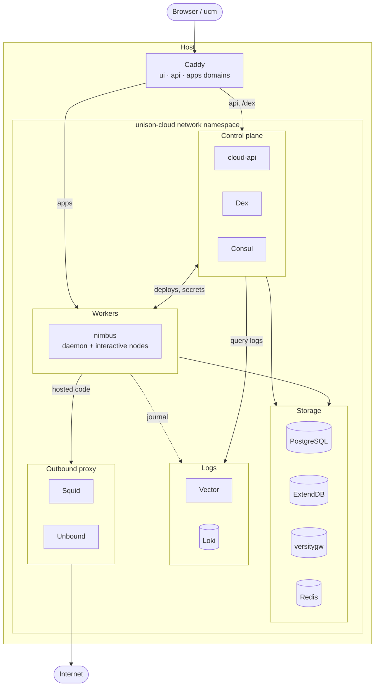

# Unison Cloud in a NixOS module

> [!WARNING]
> This is super experimental. Unison only just open sourced the pieces of Unison Cloud, and I'm running them in ways they were never really meant to run. So:
> - Expect things to break
> - Expect the options to change out from under you
> - Don't put anything you care about on it yet

This flake runs your own little [Unison Cloud](https://www.unison.cloud/) on NixOS. It packages cloud-api, nimbus, and the web UI, patches them so they work without any of Unison's hosted infrastructure including a hacky patched in auth system, and wires everything together into one `services.unison-cloud` module. You get a cluster you can log in to with `ucm`, deploy services and daemons to, and watch in the web UI.

## Try it out

The quickest way in is the demo VM. It boots the whole stack in QEMU and serves it on `localhost:8080`.

```sh
nix run .#demo
```

> [!NOTE]
> Building all of this from scratch may take a long time, mostly cloud-api's Haskell build and compiling nimbus. The flake already points at a binary cache in its `nixConfig`, so just say yes when Nix asks to trust it. See [Use the binary cache](#use-the-binary-cache) if it doesn't ask.

Once it's up you get:

- UI: http://ui.unison.localhost:8080
- API: http://cloud.unison.localhost:8080
- Deployed services: http://apps.unison.localhost:8080/services/s/demo/<service-name>/
- Login: `demo@unison.localhost` / `demo`

> [!IMPORTANT]
> The demo leans on `*.localhost` names resolving to loopback. Most browsers do this on their own, but `ucm` uses your system's resolver, so you need a system where it works too. On many Linux distros, systemd-resolved or glibc's `nss-myhostname` handle it by default. Check with `getent hosts cloud.unison.localhost`.
>
> If that's not an option, you'll have to mess around with the domain configs. Caddy routes by hostname, so a raw IP on its own won't work. You still need three names, either from `/etc/hosts` entries or something like [nip.io](https://nip.io). And plain `http` is only allowed when every domain ends in `.localhost`, so anything else means turning on TLS too.

The demo user already has a hello-world service deployed at http://apps.unison.localhost:8080/services/s/demo/hello/.

To deploy your own code to it, log `ucm` in to the cluster and then start `ucm` from the demo shell, which points the cloud client at the VM:

```sh
# Logs you into the local cloud for cloud.unison.localhost:8008
# It leaves your main Unison Share alone
$ nix run .#demo-login
$ nix develop .#demo
$ ucm
```

From there anything that you just use the normal Unison Cloud client to interact with your cloud in a bottle.

## Deploy for Real

Even I have barely done this, so YMMV to the extreme. To run it on a real machine, import `nixosModules.default` and set at least the three domains:

```nix
{
  imports = [inputs.unison-cloud-nix.nixosModules.default];

  services.unison-cloud = {
    enable = true;
    domains = {
      api = "cloud.example.com";
      apps = "apps.example.com";
      ui = "ui.example.com";
    };
  };

  networking.nftables.enable = true;
}
```

Keep the UI and API domains under the same parent domain. The session cookie only rides along on the UI's requests when they're the same site. Add users to log in with through `services.unison-cloud.auth.dex.users`, or use the generated admin account. `nix/demo/configuration.nix` is a good full example.

## Use the binary cache

Building cloud-api and nimbus from scratch takes a long time, so I push the builds to a Cachix cache, [unison-cloud-in-a-bottle](https://unison-cloud-in-a-bottle.cachix.org). The flake already lists it in `nixConfig`, so when you `nix run` or `nix develop` here Nix asks whether to trust it. Say yes and it pulls the binaries instead of building them.

If you're not a trusted user in your Nix config, Nix ignores the flake's `nixConfig` and builds everything locally. Add the cache to your system instead:

```nix
nix.settings = {
  extra-substituters = ["https://unison-cloud-in-a-bottle.cachix.org"];
  extra-trusted-public-keys = ["unison-cloud-in-a-bottle.cachix.org-1:egpjVQf3JrKM0bo39Gh3JKOMeEbyyk8t0VSH6455r8w="];
};
```

The cache has cloud-api, nimbus, ExtendDB, and the whole demo VM for `x86_64-linux` and `aarch64-linux`. The web UI gets rebuilt for your own domains when you use the module, so that one bit always builds locally.

## See how it fits together

Everything except Caddy runs inside its own network namespace (`unison-cloud`), and only a few services are allowed to talk to the outside world.

<details>
<summary>Here is a somewhat janky AI generated architecture diagram (click to expand)</summary>



</details>

- **Caddy** is the only thing listening publicly. It reaches into the namespace through unix sockets and routes three domains: the API domain goes to cloud-api (and `/dex/*` to Dex), the apps domain round-robins across the nimbus nodes, and the UI domain serves the static web UI.
- **cloud-api** is the control plane. It handles login, users, environments, secrets, and service names, and hands deploys to nimbus.
- **nimbus** is the worker that actually runs your Unison code. There's one daemon node plus a configurable number of interactive nodes (two by default).
- **Dex** is the bundled login provider. cloud-api acts as an OIDC client of Dex (or any external OIDC provider you point it at), and as a tiny authorization server for `ucm auth.login`.
- **PostgreSQL** holds cloud-api's data and environment secrets, and backs ExtendDB.
- **ExtendDB** stands in for DynamoDB, which is where nimbus keeps its transactional storage.
- **versitygw** stands in for S3, for deployed service code and blobs. You can point it at a real S3 instead.
- **Redis** holds login state and refresh tokens.
- **Consul** is a single-node service registry that cloud-api uses to find the nimbus nodes.
- **Loki and Vector** collect the logs. Vector ships nimbus's journal into Loki with the labels cloud-api expects when the UI asks for logs.
- **Squid and Unbound** form the outbound proxy for hosted code. Your services can reach the internet, but never loopback or private addresses.
- **nftables** locks down egress from the namespace so only the services that need the outside world can reach it.

All secrets (keys, passwords, an internal CA) are generated on first boot under the state directory, and any of them can be overridden with your own files.

## See what I patched

To get this to all work semi reasonable and securely I made a whole boatload of patches. Some for conviences, and some are totally necessary to get it to work at all. Below is a full list with the specific reasons they were created.

cloud-api (`patches/cloud-api/`):

- `0001-remove-unused-api-types`: Drops two unused API type aliases.
- `0002-production-mode-fixes`: Lets you set the S3 endpoint and addressing style, and makes the email service optional.
- `0003-vault-to-postgres`: Replaces Vault with a Postgres table for environment secrets, served over the bit of Vault's API that nimbus uses.
- `0004-header-trust-login`: Adds a self-hosted login that trusts identity headers from a reverse proxy and auto-provisions users.
- `0005-session-error-redirect`: Sends login errors to your own UI instead of `app.unison.cloud`.
- `0006-environment-access-check`: Actually rejects the request when the environment access check fails, instead of ignoring the result.
- `0007-cookie-secure-from-origin`: Sets the cookie `Secure` flag from the API's scheme, so login works over plain HTTP.
- `0008-oidc-broker`: Makes cloud-api an OIDC client of Dex or any other provider, and the login server `ucm auth.login` talks to.

unison-cloud-ui (`patches/cloud-ui/`):

- `0001-remove-intercom`: Removes the Intercom support chat widget.
- `0002-remove-billing`: Removes the subscription and billing pages.
- `0003-remove-status-link`: Removes the status page link from the footer.
- `0004-path-based-service-urls`: Links deployed services under your apps domain by path, so you don't need wildcard DNS.

nimbus (`patches/nimbus/`):

- `0001-dynamo-https.u`: Adds a DynamoDB config that talks HTTPS to a local endpoint, so nimbus can use ExtendDB.
- `0002-unproxied-internal-traffic.u`: Keeps nimbus's own storage traffic off the outbound proxy, so the proxy can block every private address.

## Thanks

This only exists because of a bunch of other people's work on a bunch of projects:

- [Unison](https://www.unison-lang.org/), for open sourcing [cloud-api](https://github.com/unisonweb/cloud-api), [nimbus](https://share.unison-lang.org/@unison/nimbus), and [unison-cloud-ui](https://github.com/unisonweb/unison-cloud-ui), and for the language itself.
- [unison-nix](https://github.com/ceedubs/unison-nix), for packaging `ucm`.
- [stacklock2nix](https://github.com/cdepillabout/stacklock2nix), for making the cloud-api Haskell build painless.
- [ExtendDB](https://github.com/ExtendDB/extenddb), for a DynamoDB I can run myself.
- [versitygw](https://github.com/versity/versitygw), [Dex](https://dexidp.io/), [Caddy](https://caddyserver.com/), [PostgreSQL](https://www.postgresql.org/), [Redis](https://redis.io/), [Consul](https://www.consul.io/), [Grafana Loki](https://grafana.com/oss/loki/), [Vector](https://vector.dev/), [Squid](https://www.squid-cache.org/), and [Unbound](https://nlnetlabs.nl/projects/unbound/).
- [NixOS](https://nixos.org/) and nixpkgs, for making it possible to wire all of this together in one place.
