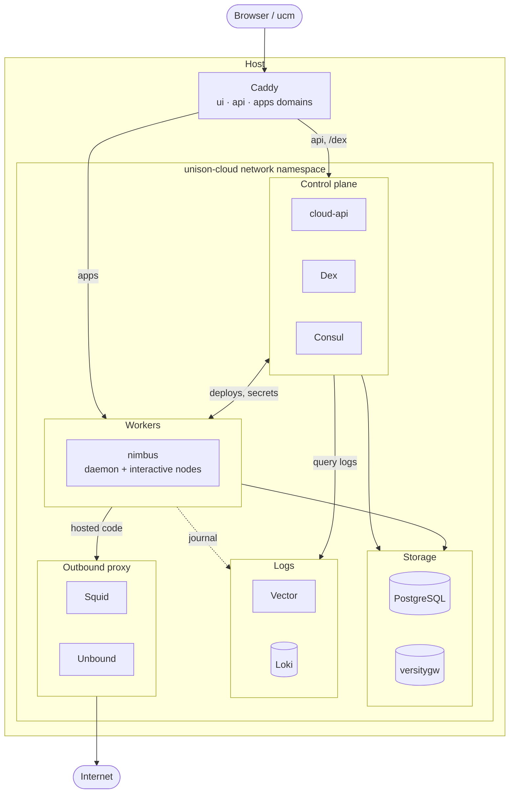

# Unison Cloud in a NixOS module

> [!WARNING]
> This is super experimental. Unison only just open sourced the pieces of Unison Cloud, and I'm running them in ways they were never really meant to run. So:
> - Expect things to break
> - Expect the options to change out from under you
> - Don't put anything you care about on it yet

This flake runs your own little [Unison Cloud](https://www.unison.cloud/) on NixOS. It packages cloud-api, nimbus, and the web UI, patches them so they work without any of Unison's hosted infrastructure including a hacky patched in auth system, and wires everything together into one `services.unison-cloud` module. You get a cluster you can log in to with `ucm`, deploy services and daemons to, and watch in the web UI.

## Try it out

The quickest way in is the demo VM. It boots the whole stack in QEMU and serves it on `localhost:8080`.

```sh
nix run .#demo
```

> [!NOTE]
> Building all of this from scratch may take a long time, mostly cloud-api's Haskell build and compiling nimbus. The flake already points at a binary cache in its `nixConfig`, so just say yes when Nix asks to trust it. See [Use the binary cache](#use-the-binary-cache) if it doesn't ask.

Once it's up you get:

- UI: http://ui.unison.localhost:8080
- API: http://cloud.unison.localhost:8080
- Deployed services: http://apps.unison.localhost:8080/services/s/demo/<service-name>/
- Login: `demo@unison.localhost` / `demo`

> [!IMPORTANT]
> The demo leans on `*.localhost` names resolving to loopback. Most browsers do this on their own, but `ucm` uses your system's resolver, so you need a system where it works too. On many Linux distros, systemd-resolved or glibc's `nss-myhostname` handle it by default. Check with `getent hosts cloud.unison.localhost`.
>
> If that's not an option, you'll have to mess around with the domain configs. Caddy routes by hostname, so a raw IP on its own won't work. You still need three names, either from `/etc/hosts` entries or something like [nip.io](https://nip.io). And plain `http` is only allowed when every domain ends in `.localhost`, so anything else means turning on TLS too.

The demo user already has a hello-world service deployed at http://apps.unison.localhost:8080/services/s/demo/hello/.

To deploy your own code to it, log `ucm` in to the cluster and then start `ucm` from the demo shell, which points the cloud client at the VM:

```sh
# Logs you into the local cloud for cloud.unison.localhost:8008
# It leaves your main Unison Share alone
$ nix run .#demo-login
$ nix develop .#demo
$ ucm
```

From there anything that you just use the normal Unison Cloud client to interact with your cloud in a bottle.

## Deploy for Real

Even I have barely done this, so YMMV to the extreme. To run it on a real machine, import `nixosModules.default` and set at least the three domains:

```nix
{
  imports = [inputs.unison-cloud-nix.nixosModules.default];

  services.unison-cloud = {
    enable = true;
    domains = {
      api = "cloud.example.com";
      apps = "apps.example.com";
      ui = "ui.example.com";
    };
  };

  networking.nftables.enable = true;
}
```

Keep the UI and API domains under the same parent domain. The session cookie only rides along on the UI's requests when they're the same site. Add users to log in with through `services.unison-cloud.auth.dex.users`, or use the generated admin account. `nix/demo/configuration.nix` is a good full example.

## Deploy on a shared host

If the host already runs its own Caddy, login provider, PostgreSQL and S3 store, the module can use all four. Hosted code runs as `unison-cloud-nimbus`, and the network namespace only isolates TCP and UDP. So the module sandboxes nimbus so it can't see the host's unix sockets or `/run` and `/var` at all. Every path out to a host service is a bridge that only the users who need it can open.

This example is for a host whose Caddy wraps each vhost's body in its own `tls` block, with Pocket ID on `127.0.0.1:1411`, the host's PostgreSQL, and Garage on a private network:

```nix
{config, ...}: let
  cloud = config.services.unison-cloud;
in {
  imports = [inputs.unison-cloud-nix.nixosModules.default];

  services.unison-cloud = {
    enable = true;
    domains = {
      api = "cloud.example.com";
      apps = "apps.example.com";
      ui = "ui.example.com";
    };

    # Your Caddy serves the three sites from the module's site bodies.
    caddy.enable = false;

    auth = {
      dex.enable = false;
      oidc = {
        issuer = "https://login.example.com";
        clientId = "unison-cloud";
        # systemd-creds encrypt --name=oidc-client-secret - /etc/credstore.encrypted/unison-cloud-oidc-client-secret
        clientSecretCredential = "unison-cloud-oidc-client-secret";
        # The browser follows the public authorization URL. cloud-api fetches tokens and
        # keys through a bridge to Pocket ID's own listener, so it needs no egress.
        endpoints.authorization = "https://login.example.com/authorize";
        bridge = {
          target = "127.0.0.1:1411";
          tokenPath = "/api/oidc/token";
          jwksPath = "/.well-known/jwks.json";
        };
        allowedGroups = ["unison-cloud"];
      };
    };

    s3 = {
      bundled = false;
      buckets = {
        services = "unison-cloud-example-services";
        userBlobs = "unison-cloud-example-user-blobs";
      };
      external = {
        # Garage's root_domain is ".s3.garage.example.com". The bucket names resolve to
        # the bridge inside cloud-api and nimbus only.
        host = "s3.garage.example.com";
        https = false;
        region = "garage";
        bridge.target = "10.100.0.3:3900";
      };
    };
    # Encrypted with --name=s3-access-key-id and --name=s3-secret-access-key.
    secrets.credentials = {
      s3-access-key-id = "unison-cloud-s3-access-key-id";
      s3-secret-access-key = "unison-cloud-s3-secret-access-key";
    };

    database = {
      mode = "host";
      package = config.services.postgresql.package;
    };
  };

  services.caddy.virtualHosts = {
    "cloud.example.com".extraConfig = cloud.caddy.siteConfig.api;
    "apps.example.com".extraConfig = cloud.caddy.siteConfig.apps;
    "ui.example.com".extraConfig = cloud.caddy.siteConfig.ui;
  };

  networking.nftables.enable = true;
  # Egress turns on IPv4 forwarding; this keeps the host from routing anything else.
  networking.firewall.filterForward = true;
}
```

Here's what each piece expects from the host:

- **Caddy.** It must run as group `caddy`, or set `ingressGroup` to its group. The sockets under `/run/unison-cloud/` reach cloud-api's `/internal/*` routes, which Caddy keeps private, so keep that group to Caddy. They grant no login: cloud-api only logs you in through OIDC. Point a monitor at `https://cloud.example.com/.well-known/openid-configuration`. It needs no login, and a 200 means Caddy and cloud-api are up.
- **The login provider.** Give it a confidential client with the redirect URI `https://cloud.example.com/selfhost/oidc/callback`. cloud-api still checks every ID token's `iss` against the public issuer.
- **PostgreSQL.** The module creates `unison-cloud-api` and `unison-cloud-nimbus` roles, both `NOSUPERUSER`, `NOCREATEROLE` and `NOCREATEDB`, and their databases. cloud-api logs in over `/run/postgresql` with peer authentication. nimbus can't open a unix socket, so it logs in with a generated password, through a bridge to the host's `127.0.0.1`. The module never touches `pg_hba.conf`, so keep rules that let those system users log in as their own roles, and `unison-cloud-nimbus` with its password over TCP from `127.0.0.1`. NixOS's defaults, `local all all peer` and `host all all 127.0.0.1/32 md5`, do both.
- **S3.** Create both buckets and a key that can read and write them. Requests through the bridge keep the `Host` header the clients sign, `<bucket>.<host>:7070`, so the store must accept a non-default port there. Garage does.

## Use an existing Consul cluster

Everything the stack keeps in Consul sits under one prefix, `consul.prefix` (`unison-cloud` by default): KV keys under `<prefix>/` and service names starting with `<prefix>-`. So it can share a cluster that runs with `default_policy = "deny"`. The module writes the ACL policy it needs to `config.services.unison-cloud.consul.aclPolicy`. Create the policy and a token from it on the cluster:

```sh
policy=$(nix build --no-link --print-out-paths .#nixosConfigurations.<host>.config.services.unison-cloud.consul.aclPolicy)
consul acl policy create -name unison-cloud -rules @"$policy"
consul acl token create -policy-name unison-cloud -description "Unison Cloud"
```

Then point the module at the host's local agent through a host bridge, and supply the token's secret ID as `consul-token`:

```nix
services.unison-cloud = {
  consul = {
    bundled = false;
    address = "http://127.0.0.1:18500";
  };
  network.hostBridges.consul = {
    target = "127.0.0.1:8500";
    port = 18500;
    users = ["unison-cloud-api"];
  };
  # Encrypted with --name=consul-token.
  secrets.credentials.consul-token = "unison-cloud-consul-token";
};
```

`unison-cloud-consul-services` registers the host's nimbus client ports and cloud-api with the local agent, as `<prefix>-nimbus-client` and `<prefix>-cloud-api`, while it runs, and deregisters them when it stops. It runs as `unison-cloud-api` too, so the bridge above covers it.

## Use the binary cache

Building cloud-api and nimbus from scratch takes a long time, so I push the builds to a Cachix cache, [unison-cloud-in-a-bottle](https://unison-cloud-in-a-bottle.cachix.org). The flake already lists it in `nixConfig`, so when you `nix run` or `nix develop` here Nix asks whether to trust it. Say yes and it pulls the binaries instead of building them.

If you're not a trusted user in your Nix config, Nix ignores the flake's `nixConfig` and builds everything locally. Add the cache to your system instead:

```nix
nix.settings = {
  extra-substituters = ["https://unison-cloud-in-a-bottle.cachix.org"];
  extra-trusted-public-keys = ["unison-cloud-in-a-bottle.cachix.org-1:egpjVQf3JrKM0bo39Gh3JKOMeEbyyk8t0VSH6455r8w="];
};
```

The cache has cloud-api, nimbus, and the whole demo VM for `x86_64-linux` and `aarch64-linux`. The web UI gets rebuilt for your own domains when you use the module, so that one bit always builds locally.

## See how it fits together

Everything except Caddy runs inside its own network namespace (`unison-cloud`), and only a few services are allowed to talk to the outside world.

<details>
<summary>Here is a somewhat janky AI generated architecture diagram (click to expand)</summary>



</details>

- **Caddy** is the only thing listening publicly. It reaches into the namespace through unix sockets and routes three domains: the API domain goes to cloud-api (and `/dex/*` to Dex), the apps domain round-robins across the nimbus nodes, and the UI domain serves the static web UI.
- **cloud-api** is the control plane. It handles login, users, environments, secrets, and service names, and hands deploys to nimbus.
- **nimbus** is the worker that actually runs your Unison code. There's one daemon node plus a configurable number of interactive nodes (two by default).
- **Dex** is the bundled login provider. cloud-api acts as an OIDC client of Dex (or any external OIDC provider you point it at), and as a tiny authorization server for `ucm auth.login`.
- **PostgreSQL** holds cloud-api's data, environment secrets, login state and refresh tokens, and nimbus's transactional storage in place of DynamoDB. Each has its own role, and neither can read the other's tables.
- **versitygw** stands in for S3, for deployed service code and blobs. You can point it at a real S3 instead, reached through a host bridge.
- **Consul** is a single-node service registry that cloud-api uses to find the nimbus nodes. It runs with ACLs on and denies anonymous requests. At boot it creates the `consul.aclPolicy` policy and cloud-api's token from it, so the stack uses the same token path as on a shared cluster.
- **Loki and Vector** collect the logs. Vector ships nimbus's journal into Loki with the labels cloud-api expects when the UI asks for logs.
- **Squid and Unbound** form the outbound proxy for hosted code. Your services can reach the internet, but never loopback or private addresses.
- **nftables** locks down egress from the namespace so only the services that need the outside world can reach it. Host bridges (`network.hostBridges`) give named users a path to one host-side service each, such as an S3 store or a login provider, without any general egress.
- **systemd sandboxing** covers what the namespace can't: unix sockets and files. nimbus and cloud-api run with `/run` and `/var` emptied, and nimbus can't open a unix socket at all.

All secrets (keys and passwords) are generated on first boot under the state directory. You can override any of them with your own files (`secrets.files`), and most of them with systemd encrypted credentials (`secrets.credentials`).

## See what I patched

To get this to all work semi reasonable and securely I made a whole boatload of patches. Some for conviences, and some are totally necessary to get it to work at all. Below is a full list with the specific reasons they were created.

cloud-api (`patches/cloud-api/`):

- `0001-remove-unused-api-types`: Drops two unused API type aliases.
- `0002-production-mode-fixes`: Lets you set the S3 endpoint and addressing style, and makes the email service optional.
- `0003-vault-to-postgres`: Replaces Vault with a Postgres table for environment secrets, served over the bit of Vault's API that nimbus uses.
- `0004-selfhost-user-provisioning`: Creates a cloud-api user the first time an OIDC identity logs in, keyed on the provider's subject, and enrolls it in the default tier.
- `0005-environment-access-check`: Actually rejects the request when the environment access check fails, instead of ignoring the result.
- `0006-cookie-secure-from-origin`: Sets the cookie `Secure` flag from the API's scheme, so login works over plain HTTP.
- `0007-oidc-broker`: Makes cloud-api an OIDC client of Dex or any other provider, and the login server `ucm auth.login` talks to. It's the only way to log in.
- `0008-remove-unauthenticated-routes`: Removes the routes that answer without a real login, so nothing on the host can reach cloud-api's port and become a user or change state. That covers the Share login (`/login`, `/oauth/redirect`, `/enroll`), the credential-free `/local/*` logins, the Stripe webhook (its secret is a public placeholder), and the `/internal` lookups nimbus replaced with `/v2/cluster`. `/internal/invalidate` now refuses every call when its token is unset.
- `0009-redis-to-postgres`: Replaces Redis with a Postgres table for login state, authorization codes and refresh tokens, so there's one less service to run. Expired entries are skipped on read and deleted on write, without a timer. Codes and refresh tokens are now consumed in one statement, so two racing requests can't both redeem one.
- `0010-consul-token-and-prefix`: Sends `CONSUL_HTTP_TOKEN` as `X-Consul-Token` on every Consul request, and puts every key and service name under `CLOUD_CONSUL_PREFIX` (`unison-cloud` by default), so cloud-api can live on a shared cluster with a narrow ACL policy. Daemon assignments move to `<prefix>/daemons/<cluster>/`, custom domains to `<prefix>/userdomains/`, and the services become `<prefix>-nimbus-http`, `<prefix>-nimbus-client` and `<prefix>-cloud-api`.

unison-cloud-ui (`patches/cloud-ui/`):

- `0001-remove-intercom`: Removes the Intercom support chat widget.
- `0002-remove-billing`: Removes the subscription and billing pages.
- `0003-remove-status-link`: Removes the status page link from the footer.
- `0004-path-based-service-urls`: Links deployed services under your apps domain by path, so you don't need wildcard DNS.

nimbus (`patches/nimbus/`):

- `0002-unproxied-internal-traffic.u`: Keeps nimbus's own storage traffic off the outbound proxy, so the proxy can block every private address.
- `0003-postgres-config.u` and `0004-postgres-storage.u`: Store nimbus's transactional data in a PostgreSQL table instead of DynamoDB, through [@runarorama/postgres](https://share.unison-lang.org/@runarorama/postgres), so there's no DynamoDB stand-in to run. Concurrent transactions conflict and retry the way they do on DynamoDB, and a small pool of long-lived sessions avoids logging in on every query.

## Thanks

This only exists because of a bunch of other people's work on a bunch of projects:

- [Unison](https://www.unison-lang.org/), for open sourcing [cloud-api](https://github.com/unisonweb/cloud-api), [nimbus](https://share.unison-lang.org/@unison/nimbus), and [unison-cloud-ui](https://github.com/unisonweb/unison-cloud-ui), and for the language itself.
- [unison-nix](https://github.com/ceedubs/unison-nix), for packaging `ucm`.
- [stacklock2nix](https://github.com/cdepillabout/stacklock2nix), for making the cloud-api Haskell build painless.
- [@runarorama/postgres](https://share.unison-lang.org/@runarorama/postgres), for a PostgreSQL client nimbus can use.
- [versitygw](https://github.com/versity/versitygw), [Dex](https://dexidp.io/), [Caddy](https://caddyserver.com/), [PostgreSQL](https://www.postgresql.org/), [Consul](https://www.consul.io/), [Grafana Loki](https://grafana.com/oss/loki/), [Vector](https://vector.dev/), [Squid](https://www.squid-cache.org/), and [Unbound](https://nlnetlabs.nl/projects/unbound/).
- [NixOS](https://nixos.org/) and nixpkgs, for making it possible to wire all of this together in one place.
